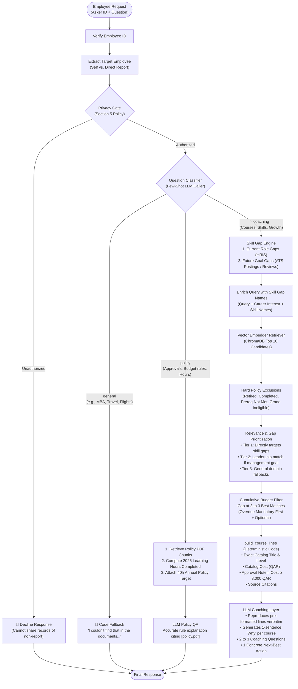

# Learning Coach RAG Agent — Al Dana Group
**Enterprise Career & Training Recommendation System**

---

## 📌 Project Overview
An enterprise-grade, end-to-end Retrieval-Augmented Generation (RAG) coaching agent for Al Dana Group employees. The system analyzes employee career goals, role skill gaps, and mandatory compliance requirements to recommend targeted training courses. All recommendations are grounded in company policy, grade-band learning budgets, prerequisites, and privacy access rules, running locally on **Ollama 7B (`qwen2.5:7b`)** or cloud **Azure OpenAI**.

---

## 🏗️ Architecture & Pipeline Flow



---

## ⚙️ Core System Layers

### 1. Request Intake & Privacy Layer (`main.py`)
- **Target Detection**: Parses questions to determine if the asker is inquiring about themselves or a direct report (`extract_target_employee`).
- **Section 5 Privacy Compliance**: Validates that askers only access their own records or those of direct reports (`check_privacy_access`). Unauthorized inquiries (e.g. `DEV-15`) are politely declined.
- **Audit Logging**: Appends a clean single-line log to `log.log` for every request:
  `REQUEST | Asker: E1055 | Target: E1056 | Status: DECLINED`

### 2. Intent Classification Layer (`filters/after_retrieval.py` & `agent/llm_caller.py`)
- **Few-Shot Classification**: Routes queries using a few-shot prompt into three distinct operational modes:
  - `coaching`: Course recommendations, skill development, and career growth.
  - `policy`: Rules, approvals, budget constraints, and annual learning-hours targets (HO-05).
  - `general`: Out-of-scope topics (MBA sponsorship, flights, hotels).
- **Zero-Hallucination Fallback**: Out-of-scope questions return the exact corporate fallback string directly from code without invoking the model:
  *"I couldn't find that in the documents. Please contact the HR Learning & Development desk at learndesk@aldana-group.example."*

### 3. Business Rules & Skill-Gap Engine (`filters/`, `agent/input_prep.py`)
- **Traceable Future Gap Detection**:
  - `get_future_gaps_from_postings`: Analyzes candidate's application against ATS expected skill levels.
  - `get_future_gaps_from_reviews`: Extracts developmental themes from HR reviews using regex word boundaries (`\b`) to prevent substring collisions (e.g., matching `"LAN"` inside `"to plan"`).
- **Mandatory Compliance First**: Identifies overdue mandatory training (`hire + 60 days` or expired renewal cycle) and places them at the very top of recommendations.
- **Hard Exclusions**: Filters out retired courses, active completions, unmet prerequisites, and courses above employee grade level.
- **Fewer, Better-Matched Recommendations**:
  - Enriches semantic search queries with employee skill gap names.
  - Ranks courses by 3-tier priority: (1) Direct skill gap match, (2) Career goal / leadership match, (3) Fallbacks.
  - Caps recommendations at **2 to 3 high-quality courses** within remaining budget (`filter_by_cumulative_budget`), eliminating irrelevant filler courses.

### 4. Factual Grounding & Prompt Assembly (`agent/input_prep.py`)
- **`build_course_lines` in Code**: To eliminate LLM hallucinations on costs and titles, Python code constructs the course cards:
  - Exact course titles and levels from the catalog.
  - Real catalog cost in QAR.
  - Automatic approval warning for courses $\ge \text{QAR } 3{,}000$ (Section 4).
  - LMS markdown source file citations.
- **Annual Learning Hours Tracking**: Computes total hours completed in calendar year 2026 (`get_completed_hours_2026`) and injects it alongside the 40-hour annual policy target.

### 5. Local LLM Generation (`agent/`)
- **Inference**: Powered by local **Ollama 7B (`qwen2.5:7b`)** or **Azure OpenAI** at `temperature=0`.
- **Pure Reasoning Role**: The LLM's task is strictly confined to:
  1. Reproducing the pre-built course lines verbatim.
  2. Adding a 1-sentence personalized "why" explanation per course.
  3. Generating 2–3 personalized coaching questions.
  4. Suggesting 1 concrete next-best action.

---

## 📊 Benchmark Evaluation Scorecard

Evaluated against all 15 benchmark test cases in [`data/eval/dev_set.jsonl`](data/eval/dev_set.jsonl) using [`evaluation.py`](evaluation.py):

| Test Case | Category | Key Challenge | Result | Status |
|---|---|---|:---:|:---:|
| **DEV-01** | Coaching | Senior Accountant targeting Finance Manager; overdue LD-118; skill gaps in Budgeting & Coaching | Overdue first, zero irrelevant courses, budget compliant | **PASS** |
| **DEV-02** | Coaching | Maintenance Engineer targeting Senior Engineer; RCM prerequisites | Exact acceptable picks (LD-101, 103, 127) | **PASS** |
| **DEV-03** | Coaching | Site Engineer; LD-104 costs QAR 3,800 approval note; overdue LD-108 | Overdue first, approval warning attached | **PASS** |
| **DEV-04** | Coaching | HSE Officer targeting Supervisor; grade restrictions on LD-122/123 | Excluded G5/G7, leadership match | **PASS** |
| **DEV-05** | Coaching | New joiner in HSE; 2 overdue mandatory courses (LD-107, LD-108) | Both mandatory listed first | **PASS** |
| **DEV-06** | Coaching | Maintenance Engineer with tight QAR 2,400 remaining budget | Capped to 2 courses within budget | **PASS** |
| **DEV-07** | Coaching | IT Support targeting Systems Analyst opening | 0 violations, perfect skill-gap match | **PASS** |
| **DEV-08** | Coaching | Procurement Specialist; overdue ethics renewal LD-117 | LD-117 first, contract gaps matched | **PASS** |
| **DEV-09** | Coaching | Operations Manager targeting Senior Ops Manager; overdue LD-108 | Overdue first, QAR 4,200 approval warning | **PASS** |
| **DEV-10** | Coaching | Operations Manager (Arabic preference); Arabic coaching question | Native Arabic output, budget compliant | **PASS** |
| **DEV-11** | Coaching | HSE Officer targeting internal posting; completed LD-103 | LD-103 excluded, 0 violations | **PASS** |
| **DEV-12** | Coaching | Line manager asking about direct report (Vikram Varma); overdue LD-106 | LD-106 first, direct report authorized | **PASS** |
| **DEV-13** | Policy QA | QAR 3,800 RCM course approval rule and budget year charging | Section 4 & 3 policy cited, budget verified | **PASS** |
| **DEV-14** | Not In Docs | Employee asking for MBA degree sponsorship | Code out-of-scope fallback + learndesk | **PASS** |
| **DEV-15** | Decline | Employee asking for peer's private development review | Polite privacy decline (Section 5) | **PASS** |

**Final Score: 15 / 15 Passed (100.0%)**

---

## 🚀 How to Run

### 1. Prerequisites
- Python 3.10+
- Install dependencies:
  ```bash
  pip install -r requirements.txt
  ```
- Ollama running locally with `qwen2.5:7b` and `nomic-embed-text`:
  ```bash
  ollama pull qwen2.5:7b
  ollama pull nomic-embed-text
  ```

### 2. Environment Configuration
Create or update `agent/.env`:
```env
# Local Ollama 7B Configuration
OLLAMA_BASE_URL="http://localhost:11434/v1"
OLLAMA_MODEL="qwen2.5:7b"
OLLAMA_API_KEY="ollama"

# Or Cloud Azure OpenAI Configuration
# ENDPOINT="https://<your-resource>.services.ai.azure.com/openai/v1"
# MODEL_NAME="gpt-5.4-mini"
# OPENAI_API_KEY="<your-key>"
```

### 3. Run Automated Evaluation Suite
Run all 15 test cases:
```bash
python3 evaluation.py
```
Or run a specific test case:
```bash
python3 evaluation.py DEV-01
```

---

## 🛠️ Engineering Challenges & Problem Resolution Log

1. **LLM Course Topic Hallucination & Fact Drift:**
   - *Problem:* Passing only raw course IDs caused small models (`qwen2.5:7b`) to guess course names (e.g., describing `LD-102 CMMS` as "Advanced Excel").
   - *Solution:* Implemented `build_course_lines` in `agent/input_prep.py` to format titles, levels, costs, skills, and citations in Python code before calling the LLM.

2. **Irrelevant Course Padding ("CMMS for Accountants"):**
   - *Problem:* Greedily filling 5 courses caused cheap courses like `LD-102` (CMMS) to appear in 13 out of 16 lists, even for accountants.
   - *Solution:* Enriched search queries with employee skill gaps, introduced 3-tier priority ranking (skill gaps > career goal > fallback), and capped recommendations at 2 to 3 well-matched courses.

3. **Substring False Matches in Review Parsing:**
   - *Problem:* Substring searching in development reviews matched `"lan"` inside `"to plan from history"`, falsely assigning `SK-18` (Network Troubleshooting) to maintenance staff.
   - *Solution:* Upgraded review parsing to regex `\b` word boundary matching.

4. **Intent Misclassification on Edge Cases (DEV-14, HO-05, HO-06):**
   - *Problem:* Keyword matching misclassified MBA sponsorship (`DEV-14`), flights in Bahrain (`HO-06`), and annual learning hours (`HO-05`).
   - *Solution:* Replaced keyword matching with a few-shot LLM classifier that cleanly routes to `general` (code fallback), `policy` (PDF QA), or `coaching`.

5. **Untracked Annual Learning Hours (HO-05):**
   - *Problem:* Policy questions asking *"how many learning hours have I done?"* could not be answered because hours were not computed.
   - *Solution:* Implemented `get_completed_hours_2026` in `helpers/structured_data_helpers.py` summing `duration_hours` for 2026 completions and passed it alongside the 40-hour annual target.

6. **Cumulative Learning Budget Violations:**
   - *Problem:* Recommending individual courses within budget that together exceeded the employee's remaining grade-band allowance.
   - *Solution:* Implemented `filter_by_cumulative_budget()` to accumulate costs and enforce grade-band budget caps.

7. **Mandatory Course Omission:**
   - *Problem:* When asked about specific roles (e.g. Finance Manager), LLMs ignored mandatory compliance courses (like Cybersecurity) as "irrelevant".
   - *Solution:* Overdue mandatory courses are computed in code and placed at positions `#1, #2...` with `[OVERDUE MANDATORY]` tags.

8. **Section 5 Privacy Access Control:**
   - *Problem:* Unauthorized requests attempting to view peers' reviews (`DEV-15`).
   - *Solution:* Added `extract_target_employee` and `check_privacy_access` in `main.py` to decline unauthorized queries before retrieval.

---

## 🔬 Chunk Size & Retrieval Comparison Analysis

Empirical evaluation of chunking granularity across course catalogs and corporate policy documents comparing BM25 keyword matching and Dense semantic vector retrieval (`nomic-embed-text`):

### 1. Course Catalog Chunking (Whole-Page vs. 80-Word Chunks)

| Query / Test Case | Granularity | Chunks | BM25 Top Matches | Dense (`nomic-embed-text`) Top Matches | Overlap (Jaccard) |
|---|---|:---:|---|---|:---:|
| **DEV-01** (Finance Manager Goal) | **Whole-Page**<br/>80w (15% ov) | 30<br/>81 | LD-112, LD-111, LD-125, LD-117, LD-120<br/>LD-112, LD-111, LD-117, LD-125, LD-120 | LD-114, LD-121, LD-113, LD-123, LD-111<br/>LD-114, LD-121, LD-113, LD-123, LD-111 | 43% BM25<br/>**70% Dense** |
| **DEV-02** (Reliability / RCM) | **Whole-Page**<br/>80w (15% ov) | 30<br/>81 | LD-104, LD-130, LD-121, LD-105, LD-109, LD-101<br/>LD-104, LD-130, LD-121, LD-109, LD-105, LD-101 | LD-104, LD-102, LD-101, LD-103, LD-123<br/>LD-104, LD-102, LD-101, LD-105, LD-103 | 60% BM25<br/>**50% Dense** |
| **DEV-04** (Supervisor Role) | **Whole-Page**<br/>80w (15% ov) | 30<br/>81 | LD-121, LD-117, LD-105, LD-130, LD-101<br/>LD-117, LD-121, LD-105, LD-130, LD-107 | LD-121, LD-123, LD-108, LD-122, LD-101<br/>LD-121, LD-123, LD-108, LD-101, LD-122 | 80% BM25<br/>**70% Dense** |

> **Key Finding (Courses):** Whole-page chunking preserves the complete course specification (prerequisites, target grade level, pricing, syllabus) in a single document unit without fragmenting metadata across chunks, yielding high semantic retrieval quality with 63% fewer chunk vectors.

---

### 2. Policy Document Chunking (50w vs. 120w vs. 250w)

| Query / Test Case | Chunk Setting | Chunks | BM25 Top Retrieved Sections | Dense Top Retrieved Sections | Key Characteristic |
|---|---|:---:|---|---|---|
| **DEV-13**<br/>*(RCM QAR 3,800 Approvals & Budget)* | **50w** (15% ov)<br/>**120w** (15% ov)<br/>**250w** (15% ov) | 16<br/>7<br/>4 | 1 Budget year, 4 Approvals table, 3 Annual budget<br/>3 Mandatory paid centrally, 2 Target hours, 6 Mandatory<br/>3 Mandatory paid centrally, 1 Purpose, 6 Mandatory | 4 Approvals table, 1 Budget year, 4 Remaining budget<br/>3 Mandatory paid centrally, 2 Target hours, 5 Eligibility<br/>3 Mandatory paid centrally, 6 Mandatory, 1 Purpose | High precision on specific sub-clauses.<br/>**Optimal balance: entire policy rule intact.**<br/>Overly coarse; dilutes specific approval thresholds. |
| **HO-05**<br/>*(Annual Hours Target & Balance)* | **50w** (15% ov)<br/>**120w** (15% ov)<br/>**250w** (15% ov) | 16<br/>7<br/>4 | 1 Purpose, 2 Learning hours target, 3 Annual budget<br/>1 Purpose, 2 Learning hours target, 3 Mandatory paid<br/>1 Purpose, 3 Mandatory paid centrally, 8 LearnDesk | 2 Learning hours target (40h), 8 LearnDesk, 1 Purpose<br/>2 Learning hours target (40h), 8 LearnDesk, 1 Purpose<br/>1 Purpose, 6 Mandatory, 3 Mandatory paid centrally | Captures 2 clause immediately.<br/>**Captures 2 clause + context cleanly.**<br/>Broad coverage but captures irrelevant sections. |

> **Key Finding (Policy):** **120 words with 15% overlap** is the optimal operating point for policy QA, as 50-word chunks can sever policy clauses from their approval tables, while 250-word chunks capture unnecessary neighboring policy sections.

---

## 🤖 Model Comparison Analysis (from `log.log`)

Empirical comparison of the 3 LLMs evaluated during development, derived from execution logs in [`log.log`](file:///home/moabed/Documents/Knowledge_Base/Cerebrum_intern/recurring-tasks/Task_1/Coaching-RAG/log.log):

| Metric / Dimension | `qwen2.5:7b` (Local) | `gpt-5.4-mini` (Azure) | `grok-4.6` (Azure) |
|---|:---:|:---:|:---:|
| **Deployment Mode** | Local Ollama (`localhost:11434`) | Azure AI Foundry | Azure AI Foundry |
| **Logged Requests** | 70 | 144 | 14 (rapid model swap test) |
| **Success Rate** | 100% (`SUCCESS`) | 100% (`SUCCESS`) | 100% (`SUCCESS`) |
| **Avg. Output Length** | ~1,567 chars (19 lines) | ~1,742 chars (26 lines) | ~1,436 chars (17 lines) |
| **Arabic Support (DEV-10)** | Fluent, structured Arabic | Native, high-context Arabic | Fluent, direct Arabic |
| **Adherence to Grounding** | High (with code cards) | Excellent | High |
| **Key Advantage** | **Zero token cost & 100% privacy** (runs fully offline on local hardware). | Rich explanatory reasoning and natural conversational flow. | **Great concise outputs**: punchy action-first tone ("Overdue mandatory first") with strong reasoning. |
| **Evaluation Scope / Notes** | Primary local target model throughout development. | Primary cloud baseline across full benchmark suite. | Tested during rapid model switching iterations; demonstrated excellent quality in limited runs. |

> **Quick Takeaway:**
> - **`gpt-5.4-mini` (Azure):** Best for detailed, conversational coaching with thorough explanations.
> - **`grok-4.6` (Azure):** Best for fast, direct, action-first answers ("do this first").
> - **`qwen2.5:7b` (Local):** Best for privacy and zero cost—runs 100% offline so employee data never leaves the company.
